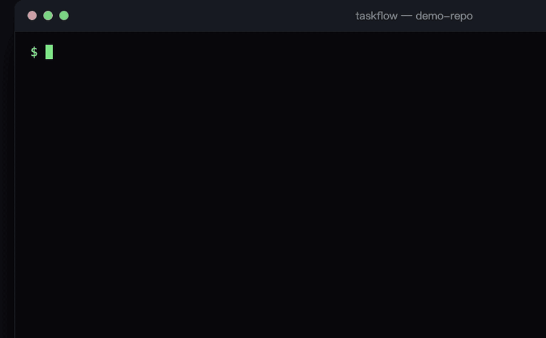

<div align="center">

# taskflow

**长任务跨会话的存档 / 恢复 / 合并管理技能**

为任何能读文件、执行 shell 的编码代理而生 —— OpenCode · Claude Code · Codex · Cursor · Hermes

自动识别意图，没有需要背的命令词。

[](LICENSE)
[](scripts/tf.mjs)
[](#安装)

**English** · [Full English README →](README.en.md)

</div>

---

> **English summary:** taskflow is a cross-session checkpoint / resume / merge skill for coding agents. Every task lives in its own git worktree with a markdown dossier; state transitions are script-enforced; merges require a fresh-context review and your final sign-off. Works with OpenCode, Claude Code, Codex, Cursor, Hermes — any agent that reads files and runs shell commands.



## 目录

- [它是怎么工作的](#它是怎么工作的)
- [安装](#安装)
- [解决什么问题](#解决什么问题)
- [快速使用](#快速使用)
- [核心机制](#核心机制)
- [命令速查](#命令速查)
- [多会话与并发](#多会话与并发)
- [提速建议](#提速建议)
- [自洽自检](#自洽自检)
- [FAQ](#faq)
- [设计要点](#设计要点)

## 它是怎么工作的

它从你说第一句话就开始了。你说"给项目加个 XX 功能"——taskflow 不写代码，先建档：fetch 最新主分支、开一个独立 git worktree、链接依赖、把需求追问成一份 spec。**你的主仓库检出区从这一刻起就保持干净**，它只作合并落点。

实现过程中，每完成一个验收点，代理自动轻量存档。你说"先到这，明天继续"——checkpoint：交接文档 + git commit + 索引刷新，三样落盘。

第二天新会话，你说"继续上次那个"。taskflow 静默盘点：列出所有任务，对照 git 事实核查（分支 HEAD、worktree 存活性、索引一致性），然后给你一份从 git 重建的恢复摘要——不是凭模型感觉，是对账过的事实。有任务在等你验收？它排在清单最顶上。

"做完了，合并吧"——合并闸门开启：强制同步主分支 → 全新上下文审查（不是干活的那个会话自己审自己）→ 呈报等你确认（code review 节点）→ 合并。另一个会话也在同时合并？排队锁让你们串行，不 rebase 竞速。

验收按 spec 里你当初确认过的「用户验收」节真机走一遍，回"验收通过"——任务才落 merged，worktree 自动清理，决策沉淀归档。下次想续迭代？归档时生成的入口句，新会话直接粘贴重入。

同一个 `.taskflow/` 档案，任何框架的会话都能读写：今天 OpenCode 开的任务，明天 Hermes 接管——有接管仪式，未提交改动逐项清点，清点完才许提交。

## 安装

### OpenCode

```bash
git clone https://github.com/LAO235Sodo/taskflow.git
ln -s "$(pwd)/taskflow" ~/.config/opencode/skills/taskflow
```

### Claude Code

```bash
git clone https://github.com/LAO235Sodo/taskflow.git
ln -s "$(pwd)/taskflow" ~/.claude/skills/taskflow
```

### Codex / Cursor（npx skills）

```bash
npx skills add LAO235Sodo/taskflow -g
```

### Hermes Agent

```bash
git clone https://github.com/LAO235Sodo/taskflow.git
ln -s "$(pwd)/taskflow" ~/.hermes/skills/taskflow
```

### 任何其他代理（最小接入）

没有技能目录机制也没关系——把 SKILL.md 的路径告诉你的代理即可。唯一 CLI 零依赖：`node scripts/tf.mjs`，本地 node 直接跑。

## 解决什么问题

- 会话太长怕丢上下文 → **checkpoint 存档**，新会话 **resume** 接着干
- 多任务并行互相踩踏 → 每任务独立 **git worktree + 分支**，物理隔离；合并端局有**排队锁**串行化
- 多会话接力怕打架 → 会话租约 + worktree 属主凭证提示「他会在途」，**takeover 一条命令完成接管**
- AI 忘记项目规矩 → **conventions.md** 项目约定文档 + 项目根 AGENTS.md 红线摘要双保险
- 覆盖别人新代码 → merge 前**强制同步主分支 + 全新上下文审查 + 你最终验收**
- 既有工作游离在体系外 → **adopt 收编**，评审卡确认后纳入管理
- 带意见回来（"页面交互乱了"）没标准动作 → **反馈分类矩阵**：打回返工走固定管线；查出根子变深先过**升级确认门**
- 同一个错反复犯 → **经验归纳协议**：批评提炼成「规则+Why+How」，查重合并，过目后双落点
- 流程打转无底洞 → **STUCK 升级门**：同一问题第 3 轮修不过，强制呈报三选一（换方案/收窄验收/revert），禁默默重试

## 快速使用

| 你说 | 它做 |
| --- | --- |
| "给项目加个 XX 功能" | 新任务建档：fetch 最新主分支 → 建 worktree → 链依赖 → 写 spec |
| "先到这，明天继续" | checkpoint：更新交接文档 + git commit + 更新索引 |
| 新会话："继续上次那个" | 列任务 → git 事实核查 → 恢复摘要 → 接着干 |
| "做完了，合并吧" | 同步 main → 强制审查（code review）→ 部署 → 人工确认部署（你点头）→ 验收通过 → 合并和清理（按项目 DoD）→ 归档 + 自动清理 worktree |
| "接手他那个任务" | takeover：改属主 + 刷新租约 + 打印桌面清点清单（清点完才许提交） |
| "两个会话都在合并" | lock merge 排队：先到先得，后到等锁，陈旧锁可强占 |
| "收编现有的分支" | 扫描 → 三板块评审卡 → 你逐个确认才纳入 |
| "这个页面交互太乱了" | 反馈分类 → 打回返工管线：意见转验收项 → 修复 → 带可视化载体呈报 → 再验收 |
| "你流程不对 / 这步跳过了" | 经验归纳：提炼规则 → 查重 → 你过目 → 记 CHANGELOG + 项目规矩 |

## 核心机制

| 机制 | 一句话 |
| --- | --- |
| 任务档案 | 每任务一套（spec/handoff/findings/progress/decisions/task.json）住 `<主仓库根>/.taskflow/<task-id>/`，永不进 git——**代码存 git 分支，叙事存 markdown** |
| 四层索引 | L0 全局注册表 → L1 项目 index → L2 task.json → L3 git commit（**唯一真相源**，索引漂移以 task.json 为准回写） |
| 物理隔离 | 所有任务一律住独立 git worktree（managed 托管/attached 挂靠你的分支），主仓库检出区只作合并落点 |
| 状态机 | `active` →(部署 `--deployed`)→ `verifying` →(验收 `--pass`)→ `merged` →(`archive`) 归层——**翻转只经脚本命令，手改 status 非法**；撤销走 `git revert -m 1`，不复活旧任务 |
| 规模分档 | small（极简仪式）/ medium（完整流程）/ large（关键决策逐项拍板）；存疑往高 |
| 不变量 | spec 唯一住处 `references/data.md`，代码侧唯一登记处 `INVARIANTS`，`doctor --self` 强制三源一致 |
| 机制登记表 | 每个机制一个 token + 触点清单，lint 强制「token 不在触点文件 = 死规则 = 红」 |
| 确认门槛 | 新建/合并/归档/远程部署逐条确认（高影响永不豁免）；可口述切 batch 档合并低影响门 |

## 命令速查

| 用途 | 命令 |
| --- | --- |
| 盘点与体检 | `ls`（任务表+游离工作）/ `doctor`（不变量体检，`--self` 校验 spec↔代码一致）/ `lint`（流程文档自检） |
| 状态翻转 | `commit --deployed`（部署）/ `accept --pass`（验收）/ `archive`（归层） |
| 多会话协作 | `takeover`（接管仪式）/ `lock`（排队锁）/ `commit --session`（乐观锁提交） |
| 检索与诊断 | `scout`（历史检索）/ `testplan`（测试计划）/ `diagnose`（证据包）/ `nextid`（占号） |
| 存量与安全提交 | `migrate`（旧目录搬迁）/ `commit --files`（声明范围防卷入） |

完整用法以 `node scripts/tf.mjs`（无参）输出为准；写入口清单见脚本头注释「能力声明」。

## 多会话与并发

- **物理隔离**：managed 任务各有独占 worktree，并行任务互不可见
- **在途可见**：会话租约（心跳 30 分钟过期）+ worktree 属主凭证（.owner.json + pid 活性）——doctor 主动提示「他会在途，续做前核对」
- **接管仪式**：前任会话已死/租约过期 → `takeover <task-id> --session <本会话ID>` 一条命令完成属主切换，并打印桌面清点清单（未提交改动逐项过目，清点完成前禁止提交）
- **乐观锁**：`commit --session` 属主不符拒写——前任会话抢不走你接管的任务
- **合并排队**：`lock merge` 端局串行化，两并行任务的合并从「互相追赶重审」变「排队」

## 提速建议

实测数据：任务耗时长的大头不是流程本身——**是「等人」和「返工」**。同日有人驱动时，medium 任务 1.5 小时、small 任务 20 分钟即可走完全流程；跨天任务的墙钟时间几乎全是会话之间的空窗。以下按杠杆从大到小排序。

### 第一梯队：现成开关，一句话激活

| 开关 | 怎么激活 | 省多少 |
| --- | --- | --- |
| **batch 确认档位** | 对代理说一句「记住：确认档位用 batch」（写进 conventions，跨会话生效） | 每任务省 3-5 次打断——低影响动作合并到组末一次报告，只剩合并/部署逐条确认 |
| **小任务明说 small** | 下需求时带一句「这个 small」 | 省 spec 质询、完整版 checkpoint、子代理审查——medium→small 差 10-20 分钟仪式 |
| **验收批量化** | 多任务一起回「这批都通过」 | 一次回话清掉多个 verifying，不再逐任务挂几天 |
| **放弃要明说** | 对挂着的任务说「放弃归档掉」 | 挂了几天的任务只有两个出口：要么「继续它」要么「放弃」——都是一句话的事 |

### 第二梯队：改变给任务的方式（减少往返轮次——返工是隐形的最大耗时）

1. **上下文一次给足**——需求、参考对象/截图、验收标准、明确不做的东西，开卡时一口气给齐
2. **反馈一次列全**——验收时把所有问题编号列成清单：一次列 10 条修一轮；分 5 次说修 5 轮
3. **关键决策当场拍**——质询队列出现时当场答完，拖到下个会话任务就悬置了
4. **规矩口述沉淀**——项目级规矩说一次，代理写进 conventions，以后每个会话自动遵守

### 第三梯队：让代理自己更快（机制层，已具备）

- **并行子代理**：零依赖改动拆分派发，编排层只做决策和审查——split 流程现成
- **多会话多任务**：两个终端各开一个任务，worktree 物理隔离 + 排队锁已就位
- **scout 防重复调研**：「之前 XX 怎么解决的」先查决策库再动手
- **及时 checkpoint 换会话**：会话过长模型响应变慢，主动「先到这」切新会话反而更快

## 自洽自检

这个技能用管理任务的方式管理自己：

- **`doctor --self`**：不变量 spec（data.md 表）↔ `INVARIANTS` 注册表 ↔ doctor 实现体，三源漂移提交时刻红灯
- **lint 七类检查**：步骤引用 / 编号连续 / 闸门关键词 / **机制触点可达**（token 不在触点文件 = 死规则）/ **事实禁改写** / 模板中性
- **棘轮原则**：同类错误第二次实证必须机制化（语义 → schema/脚本），只修文档不算修完
- **新功能 DoD**：登记 + 触点 + 机械检查 + fixture 先红后绿 + 门禁行更新，同一变更交付

## FAQ

**Q: 和 Claude Code 自带的 /compact、OpenCode 的 session resume 有什么区别？**
那些是框架内建的黑盒功能，绑定单一工具，叙事数据不可迁移。taskflow 的档案是纯 markdown+JSON，放 `.taskflow/` 平台中立——今天 OpenCode 的会话建档，明天 Hermes 的会话可以直接接管，包括接管仪式（未提交改动清点）。

**Q: 为什么不用数据库/服务器？**
零依赖单文件 CLI（tf.mjs）。代码存 git 分支、叙事存 markdown——git 已经是真相源，不重复造。

**Q: token 消耗会不会很大？**
SKILL.md 是路由器，确定动作后按需加载 `references/<对应文件>.md`；盘点/体检走脚本只读输出，不烧上下文。

**Q: 安全吗？会不会误删？**
状态翻转只经脚本命令；合并/归档/部署逐条人工确认；`commit --files` 声明范围防卷入；foreign worktree 永不自动删。

**Q: 非 git 项目能用吗？**
能，降级为纯文档存档模式（project.json 标 `"git": false`），worktree/分支/commit 能力禁用。

## 设计要点

- **数据平台中立**：任务档案与框架无关，跨框架接手无感
- **facts 归脚本，judgment 归模型**：`ls`/`doctor` 只读输出事实，判断与修复留给模型+人
- **规则可达性**：机制登记表 + lint 强制触点——规矩贴冰箱门，不住抽屉
- **主仓库永远干净**：只作合并落点，所有任务住 worktree
- **领域技能联动（双轴）**：领域轴 × 生命周期阶段轴，registry 按需注入已装技能，缺了如实注记不假装

## 结构

```
taskflow/
├── SKILL.md            # 路由器：意图识别 + 分档 + 动作路由 + 硬规则
├── scripts/            # tf.mjs 唯一 CLI（本地 node，零依赖）
├── references/         # 按动作按需加载（data.md 为唯一 spec，doctor --self 强制）
└── templates/          # 任务档案模板
```

## 版本

版本号唯一事实源为 SKILL.md（frontmatter `version` + 简介尾部版本串，lint 机械锁定一致）；逐版变更史 CHANGELOG.md 自 2.67.1 起仅本地维护，不随仓库分发。

**发版必经 release 命令（RELEASE_CHAIN）**：改完代码+手写 CHANGELOG 顶条目后，`node scripts/tf.mjs release <version>` 一条链收口——版本双点自动改 → lint → 回归 → `feat(v<版>):` 提交 → push（重试一次+远端哈希确认）→ 六路径同步（WSL 实体仓 fetch+ff-only；Windows 侧 bundle 配方）→ HEAD 对账 → 项目侧机制刷新（mech install --yes × project.json.mechanisms + doctor）→ 审计/重启提示。`--dry-run` 打印计划零执行；幂等重跑自动跳过已达成步骤；发版后审计矩阵读 managed-skills/taskflow-release-audit 走六步。

## License

[MIT](LICENSE)
