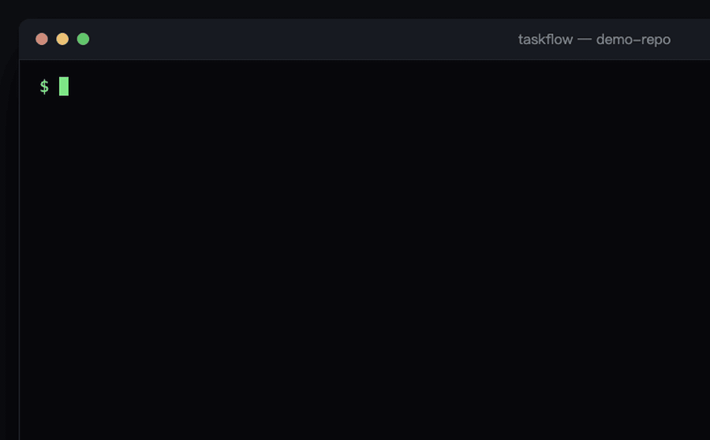

<div align="center">

# taskflow

**长任务跨会程账本：建档 · checkpoint · 恢复 · 合并 · 验收**

核心零栈私货（任意项目/技术栈可用）；栈特有能力按项目 profile 懒加载（能力包住 `packs/`）。

[](LICENSE)
[](scripts/tf.mjs)

</div>

---

长任务跨会话账本：建档、checkpoint、恢复、合并、验收。任意项目/技术栈可用——核心零栈私货，栈特有能力按项目 profile 懒加载（能力包）。

## 安装（三命令）

```bash
# 1. 克隆真源仓到统一安装位
git clone git@github.com:LAO235Sodo/taskflow.git ~/.agents/skills/taskflow

# 2. 各宿主指过来（omp / opencode；Claude Code 用 ~/.claude/skills 软链或再 clone）
ln -sfn ~/.agents/skills/taskflow ~/.omp/agent/skills/taskflow
ln -sfn ~/.agents/skills/taskflow ~/.config/opencode/skills/taskflow
```

- 全局数据根：`TF_TASKFLOW_HOME`（缺省 `~/.local/state/taskflow`）——跨安装路径/跨宿主可移植；旧 `~/.config/opencode/taskflow/` 首触达自动迁移（只读保留）。
- 更新：`node ~/.agents/skills/taskflow/scripts/tf.mjs self-update`（git pull --ff-only + 版本对账）。

## 宿主 adapter

| 宿主 | 检测 | 埋点 | 计划扫描 | 守门落点 | 红线载体 |
| --- | --- | --- | --- | --- | --- |
| omp | env/OMP 或 PATH | `~/.omp/agent/skill-usage.jsonl` | `~/.opencode/plan` | `.omp/hooks/pre/` | conventions.md |
| opencode | `~/.config/opencode` 存在 | — | — | 无（降级纯纪律档） | AGENTS.md |
| claude | `~/.claude` 存在 | — | — | 无 | CLAUDE.md |
| none | 其余/强制 `TF_HOST=none` | — | — | 无 | conventions.md |

`TF_HOST` 可强制；adapter 单点=`assets/shared/host-adapter.mjs`。

## 能力包（懒加载）

`packs/` 八包：frontend / jvm-data / deploy / docs-prd / changelog-gates / briefing / carrier / host-adapters。每包 `manifest.json`（token/triggers/assets/install_targets）+ `PACK.md`（规则全文）。项目启用态住 `.taskflow/profile.json`；未启用的包连一行都不加载。

```bash
node <skill目录>/scripts/tf.mjs packs list                    # 包清单 + 启用态
node <skill目录>/scripts/tf.mjs packs install carrier --all   # 五载体技能 → ~/.agents/skills/
node <skill目录>/scripts/tf.mjs mech install <token>          # 包内机制产物渲染进项目
```

机制机器注册表 `references/schemas/mechanisms.json` 由 `node scripts/gen-mechanisms.mjs` 从 manifests+core 种子生成（doctor I20 对账）。

## 项目 profile（`.taskflow/profile.json`）

`confirm_tier`（detailed|batch，模型禁自改）· `host` · `deploy_form`（none|jar|generic）· `packs`（启用态）· `carriers`（五载体拍板）· `task_types`（任务类型裁剪，如 mirror-precedent）· `unified_sources`。建档/resume/merge/checkpoint 四触点必读。初始化：`tf.mjs init`（升级模式只补缺不覆盖；`--ask` 单问卷）。

## v2 → v3 迁移

1. 旧项目在仓库内跑 `node <skill目录>/scripts/tf.mjs init`——升级模式补 profile.json/conventions 骨架（不覆盖既有内容，不改任务档案）；
2. 全局注册表自动迁移到 `TF_TASKFLOW_HOME`（旧文件只读保留）；
3. 任务数据 schema 兼容读；机制 token 全保留（`mech ls` 对账）。

## 发版

改完代码 + 手写 `CHANGELOG.md` 顶条目后：`node scripts/tf.mjs release <version>`（版本写入→lint→回归→commit→tag→push origin main --tags；远程不可达=警告不失败）。各安装位 `self-update` 拉取。

## 演示


